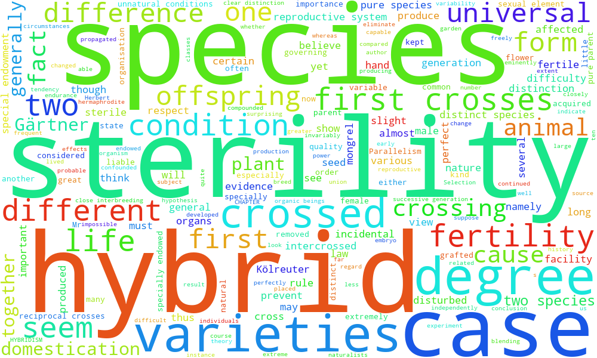

# Assignment 1: Unix and Python

## Problem 1: Number of Subjects

### A. Downloading the files

I used `git pull` to update my class repository.

### B. Number of samples

Individual 8 was sampled 17 times.

Individual 22 was sampled 5 times.

### C. Counting samples

The script `count_samples.sh` counts the number
of samples for one individual.

### D. Counting all individuals

The Python script `count_all_samples.py` reads
the data and creates `Num_samples.csv`.

## Problem 2: Mining The Origin of Species

### A. Downloading the book

I used curl to download the text.

### B. Word counts

I used grep to count the words sterility and isolation.

### C. Context

I saved three lines before and after each matching line.

### D. Word clouds




### E. Conclusion

Darwin discussed sterility and isolation, which
are important ideas in understanding how new
species can form. I do not fully agree that he
ignored the origin of new species.

## Problem 3: Twelve Days of Christmas

I used Python and nested loops to print all
12 days of the Christmas song.

## Problem 4: GitHub Submission

I used git add, git commit, and git push to
upload my assignment.

## Complete Code and Explanations

### Problem 1C: Count one individual

```bash
#!/bin/bash

# $1 is the input file
# $2 is the individual ID
# Count matching IDs in the first column
awk -F '[,\t]' -v id="$2" '$1 == id {count++} END {print count+0}' "$1"
```

This script reads the data, checks each individual ID, and counts matching samples.

### Problem 1D: Count all individuals

```python
import csv
from collections import Counter

counts = Counter()

with open("Gesquiere2011_data.csv", newline="") as file:
    reader = csv.DictReader(file)
    for row in reader:
        individual = row["maleID"]
        counts[individual] += 1

with open("Num_samples.csv", "w", newline="") as file:
    writer = csv.writer(file)
    writer.writerow(["maleID", "Num_samples"])

    for individual in sorted(counts, key=int):
        writer.writerow([individual, counts[individual]])

print("Created Num_samples.csv")
```

This program counts samples for every individual and writes Num_samples.csv.

### Problem 2: Darwin's Book

```bash
curl -L https://www.gutenberg.org/cache/epub/1228/pg1228.txt -o OriginOfSpecies.txt
grep -oiw "sterility" OriginOfSpecies.txt | wc -l
grep -oiw "isolation" OriginOfSpecies.txt | wc -l
grep -inw -C 3 "sterility" OriginOfSpecies.txt > sterility_context.txt
grep -inw -C 3 "isolation" OriginOfSpecies.txt > isolation_context.txt
conda install -c conda-forge wordcloud -y
wordcloud_cli --text sterility_context.txt --imagefile sterility.png --width 1000 --height 600 --background white
wordcloud_cli --text isolation_context.txt --imagefile isolation.png --width 1000 --height 600 --background white
```

Sterility count: **97**

Isolation count: **12**

The grep commands search for words without considering capitalization. The -C 3 option includes three lines before and after each match. Wordcloud creates pictures showing frequent words in larger text.

### Problem 3: Twelve Days of Christmas

```python
days = [
    "First", "Second", "Third", "Fourth",
    "Fifth", "Sixth", "Seventh", "Eighth",
    "Ninth", "Tenth", "Eleventh", "Twelfth"
]

gifts = [
    "A Partridge in a Pear Tree",
    "Two Turtle Doves",
    "Three French Hens",
    "Four Colly Birds",
    "Five Gold Rings",
    "Six Geese-a-Laying",
    "Seven Swans-a-Swimming",
    "Eight Maids-a-Milking",
    "Nine Ldaies Dancing",
    "Ten Lords-a-Leaping",
    "Eleven Pipers Piping",
    "Twelve Drummers Drumming"
]

for day in range(12):
    print(
        f"On the {days[day]} day of Christmas "
        "my true love gave to me:"
    )

    for gift in range(day, -1, -1):
        if gift == 0 and day > 0:
            print(gifts[gift] + (", and" if gift == 1 else ""))
        else:
            print(gifts[gift] + (", and" if gift == 1 else ""))

    if day < 11:
        print()
```

The outer loop goes through the 12 days. The inner loop prints the gifts in reverse order, adding a new gift each day.

### Problem 4: GitHub Commands

```bash
cd ~/IBC_2026_student
git add Assignments/
git commit -m "Complete Assignment 1"
git push origin main
```
