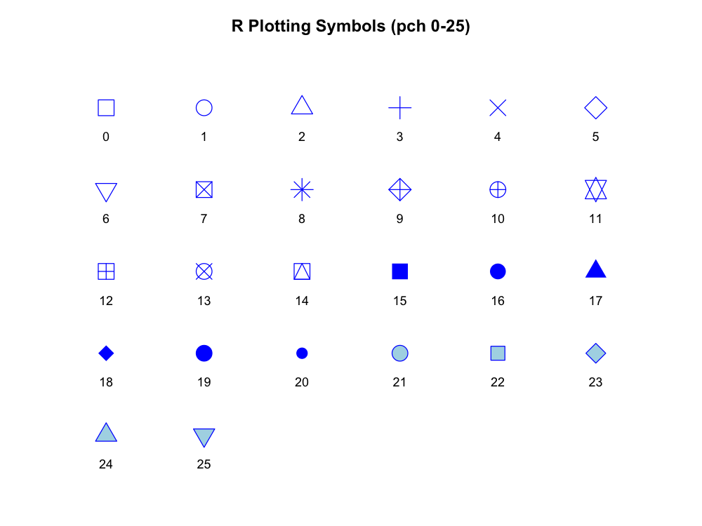
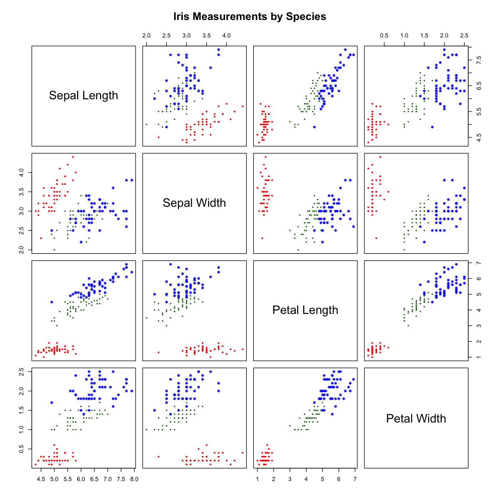

# Week 11 Practical - Data Visualization

## Problem 1: pch Symbols

I recreated the R plotting symbols chart using a for loop.

The script plots symbols 0 through 25. I used integer
division and modulo to calculate the position of each
symbol in the grid.

I did not use expand.grid().

The points() function draws the symbols, and text()
adds their numbers.

### Figure

### Code

[pch_symbols.R](pch_symbols.R)

## Problem 2: Recreate a Scientific Figure

### Original Figure

Murphy, K. P. (2012).
Machine Learning: A Probabilistic Perspective.
MIT Press. Figure 1.4.

Original figure:
https://www.cs.ubc.ca/~murphyk/MLbook/pml-intro-22may12.pdf

Figure 1.4 is a scatterplot matrix of iris measurements.
It uses colors and symbols to identify three species.

### Dataset

I used the built-in iris dataset in R.

The dataset contains 150 flowers from three species:
setosa, versicolor, and virginica.

Each flower has four measurements:
sepal length, sepal width, petal length, and petal width.

### My Recreated Figure

### Explanation

I chose this figure because it shows the relationships
between several measurements at the same time.

I recreated the scatterplot matrix using the pairs()
function in base R.

I used red, green, and blue to distinguish the species.
I also used different plotting symbols for each species.

The diagonal panels show histograms of each measurement.

The scatterplots help show how the species differ.
Setosa is especially easy to distinguish using
petal measurements.

I think the original figure is useful because it
compares several variables in one figure.

My recreation follows the same overall layout.
I used clear labels and distinct plotting symbols
to make the species easier to identify.

### Code

[recreate_figure.R](recreate_figure.R)

### Data Reference

Fisher, R. A. (1936).
The Use of Multiple Measurements in Taxonomic Problems.
Annals of Eugenics, 7, 179-188.

https://doi.org/10.1111/j.1469-1809.1936.tb02137.x

### Original Figure Image

