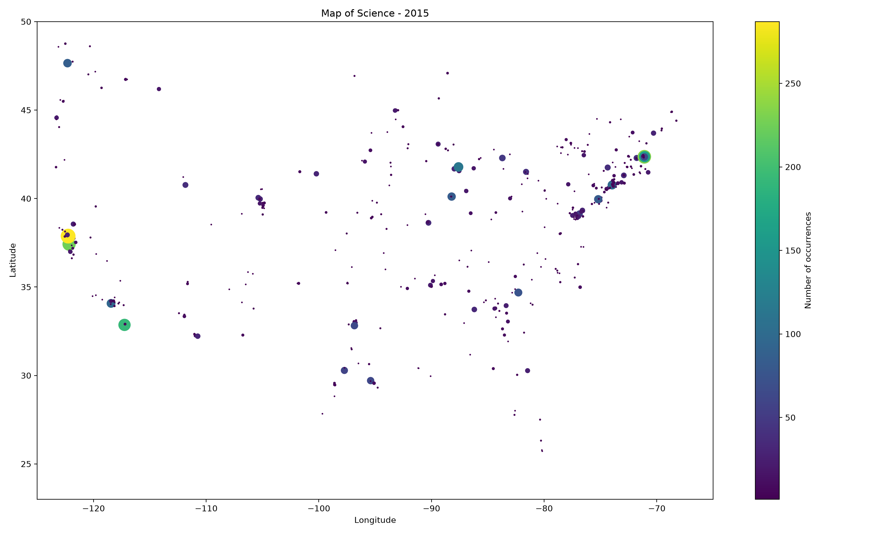

# BIOL 2214 - Week 7 Final Problems

## Map of Science

The goal of this assignment was to create a geographic map of ZIP codes associated with articles published in Science in 2015.

I used Python's re module to extract ZIP codes from pubmed_results.txt. I used Counter to count their occurrences and the csv module to match the ZIP codes with geographic coordinates from zipcodes_coordinates.txt.

I then used matplotlib to create a scatter plot showing their geographic distribution.

The Python script is saved in map_of_science.py.

## Regular Expression Exercises

1. \d matches a single digit.
2. \w*\s\d.*\d matches word characters, whitespace, a digit, any following characters, and another digit.
3. \s\w*\s matches whitespace, word characters, and whitespace.
4. \s\w{1,3}\s matches one to three word characters surrounded by whitespace.
5. \s\w*$ matches whitespace followed by word characters at the end of a string.

## GC Content

A regular expression such as [GC] matches G and C nucleotides.

GC content is calculated by dividing the number of G and C nucleotides by the total sequence length.

For AAGTCGTGAGCA, the GC content is 0.5.

## GenBank Accession Patterns

Protein: ^[A-Za-z]{3}[0-9]{5}$

Whole genome: ^[A-Za-z]{4}[0-9]{8,10}$

Nucleotide: ^([A-Za-z][0-9]{5}|[A-Za-z]{2}[0-9]{6})$

## Conclusion

This practical demonstrated how to use regular expressions to extract patterns from biological data and how to visualize geographic information using Python.
